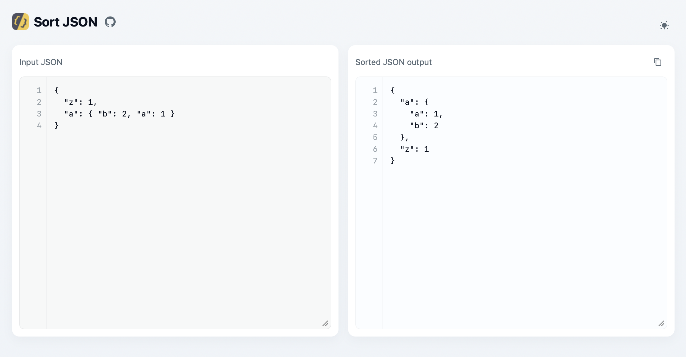

#  Sort JSON

Simple Vite + React + TypeScript app that sorts JSON keys recursively and displays a formatted output.



## Run locally

```bash
yarn install
yarn run dev
```

## Run tests

```bash
yarn run test
```

Thanks to [@AndyLnd](https://github.com/AndyLnd) for the logo!
